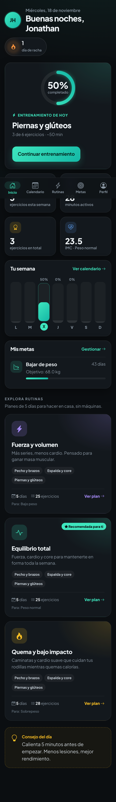
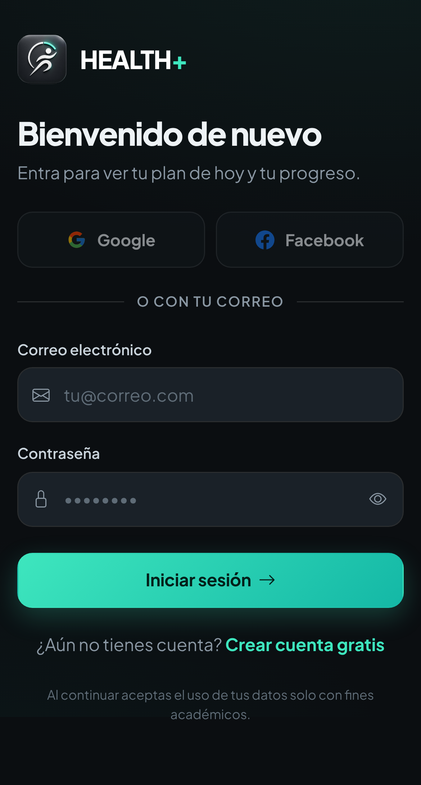

# HEALTH+

**Tu salud, un paso más cada día.**

HEALTH+ es una plataforma web, pensada primero para el celular, que ayuda a los estudiantes universitarios a crear y mantener
el hábito del ejercicio. Cada persona registra sus datos físicos, recibe un plan semanal de rutinas según su índice de
masa corporal (IMC), marca lo que va haciendo y ve su progreso, su racha y sus metas en un solo lugar.

Proyecto de **Ingeniería de Software I** · Universidad Autónoma de Manizales · 2026-III.

<p align="center">
  
  &nbsp;&nbsp;
  
</p>

## Objetivo

Ofrecer a los jóvenes universitarios, sin importar su género, condición física o experiencia, una herramienta
accesible y personalizada para entrenar en casa y sin máquinas: que sepan qué hacer cada día, por qué se lo recomendamos
y cuánto han avanzado.

### Objetivos específicos

- Registrar los datos antropométricos de cada usuario (peso, estatura, edad, sexo) y calcular su IMC.
- Recomendar un plan semanal de ejercicio acorde a su categoría de IMC.
- Permitir marcar los ejercicios realizados y mostrar el progreso diario, semanal y la racha de días activos.
- Crear metas con fecha de inicio y fin, y hacerles seguimiento.
- Garantizar un acceso seguro: verificación del correo con un código y entrada con Google o Facebook.

## Funcionalidades

| Módulo | Qué puede hacer el usuario |
| --- | --- |
| Acceso | Crear cuenta con código de 6 dígitos enviado al correo, iniciar sesión, entrar con Google o Facebook |
| Inicio | Ver el entrenamiento de hoy, su porcentaje, la racha, la gráfica de la semana, sus metas y un consejo diario |
| Perfil | Guardar datos físicos y ver su IMC; cambiar nombre y contraseña; elegir tema claro, oscuro o automático; eliminar la cuenta |
| Rutinas | Ver los 3 planes semanales (Bajo peso, Peso normal, Sobrepeso) y elegir uno; se sugiere el que corresponde a su IMC |
| Calendario y plan | Ver la semana, abrir el plan de cada día, marcar ejercicios como hechos, cambiar un ejercicio por otro o tomar el día de descanso |
| Metas | Crear, editar y eliminar metas con fecha |
| App en el celular | Desde el navegador del celular se puede "Agregar a pantalla de inicio" y se abre como una app |

## Tecnologías

| Parte | Qué usamos |
| --- | --- |
| Lenguaje | Java 21 |
| Framework | Spring Boot 4 (Spring MVC, Spring Data JPA, Spring Security) |
| Vistas | HTML con Thymeleaf, CSS propio sobre Bootstrap 5 y Bootstrap Icons |
| Base de datos | H2 en archivo en el computador; PostgreSQL cuando la app está publicada |
| Construcción | Maven (`pom.xml`, `./mvnw`) |
| Servicios externos | Gmail (SMTP) para el código de verificación; Google y Facebook (OAuth2) para iniciar sesión |
| Publicación | Docker + Render |

## Cómo ejecutarlo en tu computador

Requisitos: **JDK 21** e IntelliJ IDEA (o solo la terminal).

1. `File > Open` y elegir la carpeta que tiene `pom.xml`. Esperar a que Maven descargue las librerías.
2. Abrir `src/main/java/com/healthplus/healthplus/HealthplusApplication.java` y darle **Run**.
3. Entrar a **http://localhost:8080**.

Por terminal: `./mvnw spring-boot:run` (Mac/Linux) o `mvnw.cmd spring-boot:run` (Windows).

La primera vez la base de datos se crea sola en la carpeta `data/`, con 20 ejercicios y 15 rutinas de ejemplo.
Consola de la base de datos: **http://localhost:8080/h2-console** (JDBC URL `jdbc:h2:file:./data/healthplus;AUTO_SERVER=TRUE`,
usuario `sa`, contraseña vacía).

### Correo real, Google y Facebook (opcional)

Copia `secretos.properties.ejemplo` como `secretos.properties` (al lado de `pom.xml`) y llena solo lo que vayas a usar.
Ese archivo está en `.gitignore`: las contraseñas nunca se suben a GitHub. Sin él la app funciona igual en **modo prueba**
(el código de verificación se muestra en pantalla) y los botones de Google y Facebook aparecen desactivados.

## Publicarla en internet

La app incluye un `Dockerfile` para publicarla en Render con una base de datos PostgreSQL. En el servidor, las claves
(base de datos, correo, Google) van en un archivo secreto `secretos.properties` configurado en Render, nunca en GitHub.

## Estructura del proyecto

```
src/main/java/com/healthplus/healthplus/
├── HealthplusApplication.java   arranca la aplicación
├── config/        seguridad, login con Google/Facebook y datos iniciales (ejercicios y rutinas)
├── controlador/   reciben cada dirección (/inicio, /perfil, /metas…) y eligen qué página mostrar
├── modelo/        clases @Entity: cada una es una tabla de la base de datos
├── repositorio/   interfaces para leer y guardar en la base de datos
└── servicio/      reglas de negocio: registro con código, envío de correo, cálculo del progreso
src/main/resources/
├── templates/     páginas HTML (Thymeleaf) y fragmentos compartidos
├── static/        CSS, imágenes y archivos de la app para celular (manifest.json, sw.js)
└── application.properties
docs/
├── bd/            scripts SQL: tablas, datos de prueba y limpieza
└── capturas/      pantallazos de la aplicación
```

## Equipo Health+ (Scrum)

| Integrante | Rol | Aporte principal |
| --- | --- | --- |
| Brayan Rodríguez Ramírez | Product Owner | Código base: acceso, rutinas, plan, calendario, metas y perfil físico; backlog en Jira |
| Jonathan Stiven Hernández Valencia | Scrum Master | Módulo de inicio y progreso; integración del correo y el login social; documentación |
| Edwin Leandro Londoño González | Developer | Diseño visual (CSS): botones, colores, tarjetas y estilos de las pantallas |

## Uso de inteligencia artificial

Parte del código (registro con verificación por correo, login con Google y Facebook, página de inicio, tema claro/oscuro
y preparación para publicar) se desarrolló con apoyo de Claude (Anthropic). Todo fue revisado, probado y explicado por
el equipo, según la política del curso.
